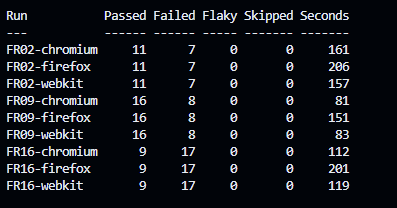

# HW04 – Automation Testing on EShop — Report

> Trần Thanh An — 23120017 — HW04-AI
> SUT: EShop (`ttbhanh/eshop-sut`, commit `85af3ba`). Công cụ: Playwright Test 1.65.1 (TypeScript), Playwright HTML reporter. AI: Claude Code (Claude Opus 5.5).

## 1. Feature

Dùng lại 3 feature Web đã chọn ở HW02 (không trùng với thành viên khác trong nhóm). Pool D (mobile) không dùng ở HW04.

| Pool | Feature | Giao diện | Report chi tiết |
|---|---|---|---|
| A | FR-02 Đăng nhập & khóa tài khoản | Web `:5173/login` | [A-FR02_Login_Lockout.md](A-FR02_Login_Lockout.md) |
| B | FR-09 Mã giảm giá | Web `:5173/checkout` | [B-FR09_Coupon.md](B-FR09_Coupon.md) |
| C | FR-16 Import sản phẩm từ CSV | Web Admin `:5174` | [C-FR16_CSV_Import.md](C-FR16_CSV_Import.md) |

## 2. Quy trình (AI-First, từng bước)

Mỗi bước là một prompt riêng của sinh viên (nguyên văn trong prompt log, phụ lục AI Audit). Mỗi bước là một hoặc vài commit có tag `[<Pool>-<FR>][<Bước>]`.

| Bước | Prompt (tóm tắt) | Kết quả | Mục trong report feature |
|---|---|---|---|
| S1 | Chọn ≥ 12 TC tự động hóa được trên Web từ danh mục HW02, phủ positive / negative / biên, giải thích TC không tự động hóa | FR-02: 18, FR-09: 24, FR-16: 26 TC | S1 |
| S2 | Chuyển TC đã chọn thành `data/frxx.json` (id, input, expected, note), không để dữ liệu trong script | 3 file JSON + 26 file CSV | S2 |
| S3 | Viết Page Object, ưu tiên `getByRole` / `getByPlaceholder` / `getByText`, không XPath / class Tailwind | `LoginPage`, `CheckoutPage`, `AdminImportPage` + helper | S3 |
| S4 | Sinh spec data-driven (mỗi phần tử một `test()`), ≥ 3 kiểu assertion | 3 spec, 68 test — commit nguyên bản AI sinh | S4 |
| S5 | Chạy, review, sửa | 6 commit sửa spec; phân loại mọi ca Fail | S5 |
| S6 | Cấu hình 3 trình duyệt + báo cáo "Run by", **sinh viên tự chạy** | 9 báo cáo HTML | S6 |
| S7 | Bug report | 15 issue HW02 được tái hiện, 0 bug mới | S7, [Bug_Report.md](Bug_Report.md) |
| S8 | Phân tích AI sai / bỏ sót | Bảng gap mỗi feature + mục 7 dưới đây | S8 |

## 3. Kiến trúc bộ test

```
data/fr02.json, fr09.json, fr16.json   # dữ liệu + kết quả mong đợi (data-driven)
data/fr16-csv/                         # 26 file CSV để import (giữ nguyên từng byte)
pages/                                 # Page Object
helpers/                               # reset backend (seed lại DB), tạo sản phẩm/coupon bằng API, đọc data
tests/fr02-login.spec.ts, fr09-coupon.spec.ts, fr16-import.spec.ts
playwright.config.ts                   # 3 project, 1 worker, HTML reporter "Run by: 23120017 — <ISO>"
scripts/run-reports.ps1                # 3 feature × 3 trình duyệt = 9 lần chạy
```

- **Data-driven:** spec đọc file JSON, mỗi phần tử sinh một `test()`. Không có mảng/đối tượng dữ liệu viết cứng trong spec.
- **Cô lập:** mỗi test khởi động lại backend (DB seed lại) rồi chuẩn bị dữ liệu bằng API. Thao tác và assertion chính diễn ra trên giao diện.

## 4. Kiểu assertion

| Kiểu | Ví dụ | Feature |
|---|---|---|
| URL trang | `expect(page).toHaveURL(...)` | FR-02, FR-09 |
| Thuộc tính DOM | `toHaveAttribute('type', 'email')` | FR-02 |
| Nội dung / hiển thị | `toContainText(/khóa/i)`, `toBeVisible()`, `toHaveText(regex ₫)` | cả 3 |
| Trạng thái phần tử | `toBeDisabled()` | FR-09, FR-16 |
| Số lượng phần tử | `toHaveCount(0)` | FR-09, FR-16 |
| Giá trị / số liệu | status response `toBe(200)`, số tiền `toBeLessThanOrEqual(0.5)`, `toHaveLength(n)` | cả 3 |
| So tập hợp / đối tượng | `toEqual(expect.arrayContaining([...]))`, `toEqual(reference.body)` | FR-02, FR-16 |
| Soft assertion | `expect.soft(...)` để báo đủ mọi lỗi trong một ca | cả 3 |

## 5. Kết quả 9 lần chạy (sinh viên tự chạy, 18/11/2026)

| Lần chạy | Báo cáo HTML | Bắt đầu (ISO, UTC) | Run by | Pass | Fail | Flaky | Giây |
|---|---|---|---|---|---|---|---|
| FR02-chromium | [`reports/FR02-chromium/`](../reports/FR02-chromium/index.html) | 2026-11-18T02:47:31.215Z | 23120017 | 11 | 7 | 0 | 161 |
| FR02-firefox | [`reports/FR02-firefox/`](../reports/FR02-firefox/index.html) | 2026-11-18T02:50:13.420Z | 23120017 | 11 | 7 | 0 | 206 |
| FR02-webkit | [`reports/FR02-webkit/`](../reports/FR02-webkit/index.html) | 2026-11-18T02:53:40.877Z | 23120017 | 11 | 7 | 0 | 157 |
| FR09-chromium | [`reports/FR09-chromium/`](../reports/FR09-chromium/index.html) | 2026-11-18T02:56:19.805Z | 23120017 | 16 | 8 | 0 | 81 |
| FR09-firefox | [`reports/FR09-firefox/`](../reports/FR09-firefox/index.html) | 2026-11-18T02:57:42.312Z | 23120017 | 16 | 8 | 0 | 151 |
| FR09-webkit | [`reports/FR09-webkit/`](../reports/FR09-webkit/index.html) | 2026-11-18T03:00:14.353Z | 23120017 | 16 | 8 | 0 | 83 |
| FR16-chromium | [`reports/FR16-chromium/`](../reports/FR16-chromium/index.html) | 2026-11-18T03:01:38.671Z | 23120017 | 9 | 17 | 0 | 112 |
| FR16-firefox | [`reports/FR16-firefox/`](../reports/FR16-firefox/index.html) | 2026-11-18T03:03:32.195Z | 23120017 | 9 | 17 | 0 | 201 |
| FR16-webkit | [`reports/FR16-webkit/`](../reports/FR16-webkit/index.html) | 2026-11-18T03:06:54.446Z | 23120017 | 9 | 17 | 0 | 119 |



- **68 TC → 204 lượt chạy: 108 Pass, 96 Fail, 0 flaky.** Tập ca Fail giống hệt nhau trên Chromium, Firefox, WebKit.
- Mọi ca Fail đều do **lỗi thật của EShop** (phân loại từng ca ở S5.2 của report feature). Không có ca nào Fail do script.

## 6. Bug

32 TC Fail ứng với **15 issue đã báo ở HW02**; **không có bug mới**, nên không tạo issue trùng. Chi tiết, ảnh trang issue: [Bug_Report.md](Bug_Report.md).
5 bug HW02 khác (#98, #99, #100, #101, #107 — gồm 3 Critical) chỉ tái hiện được ở tầng API, nằm ngoài automation UI.

## 7. Review và gap analysis script do AI sinh

### 7.1 AI sai / bỏ sót gì

| Nhóm lỗi | Số chỗ | Ví dụ | Feature |
|---|---|---|---|
| Cấu hình chạy sai | 3 | `mode: 'serial'`: một ca Fail (bug thật) làm 14 test sau bị bỏ qua | cả 3 (S5 R1) |
| Assertion thiếu (dừng ở lỗi đầu tiên) | 3 | EP-09 chỉ báo 1/4 lỗi form; FR-16 không kiểm lý do khi không rollback | cả 3 (S5) |
| Chờ không ổn định / Pass giả | 2 | `toHaveCount(0)` ngay sau response; `isVisible()` không chờ trên WebKit | FR-09 (S5), FR-16 (S3) |
| Selector sai | 1 | Chọn sai khối Import (không chứa ô chọn file) | FR-16 (S3) |
| Thông báo Fail khó chẩn đoán | 2 | "không thấy dòng Tiết kiệm sau 5 s" thay vì lý do bị từ chối | FR-09, FR-16 (S5) |
| Dữ liệu test bị môi trường làm sai | 1 | File CRLF bị Git đổi thành LF | FR-16 (S2) |
| Assertion vô nghĩa (còn lại) | 1 | `toHaveURL(/login$/)` luôn đúng ở ca bị từ chối | FR-02 (S8 G3) |
| Ca biên / ca nguy hiểm bị bỏ sót | — | 4 bug FR-09 và 1 bug FR-16 ở tầng API; tên tiếng Việt có dấu; xuống dòng trong trường CSV | S1.2, S8 |

### 7.2 Vì sao AI bỏ sót

| Nguyên nhân | Biểu hiện |
|---|---|
| **Chất lượng prompt** | Prompt S4 chỉ yêu cầu "data-driven, ≥ 3 kiểu assertion". Prompt không nói rằng bộ test có sẵn ca dự kiến Fail vì bug thật, không yêu cầu báo đủ lỗi trong một ca, cũng không yêu cầu thông báo Fail phải đủ để phân loại. Do đó AI tối ưu cho "test chạy được", không tối ưu cho "test chẩn đoán tốt" |
| **Giới hạn của model** | Viết selector và lệnh chờ khi chưa thấy DOM thật. Coi "đã có response" là "giao diện đã cập nhật". Sinh assertion theo khuôn mẫu, không xét assertion đó có phân biệt được đúng/sai không |
| **Đặc điểm feature / môi trường** | Các test dùng chung trạng thái backend (bộ đếm khóa, lượt dùng mã, số sản phẩm). Giỏ hàng chỉ lưu trong bộ nhớ trang. Thời gian khóa 30 s. WebKit vẽ chậm hơn. Git `autocrlf`. Các bug nghiêm trọng nằm ở API, giao diện không chạm tới được |

### 7.3 Số liệu

- AI sinh 3 spec / 68 test (S4). Review phát hiện **13 chỗ cần sửa** (2 ở Page Object S3, 1 ở dữ liệu S2, 10 ở spec S5), đã sửa 12, còn lại 1 (assertion vô nghĩa nhưng vô hại).
- 6 commit sửa spec sau review (S5). Tổng **9 commit có thay đổi file `.spec.ts`** (≥ 8 theo đề).

> **Ghi chú quy trình (minh bạch):** sinh viên gõ prompt cho từng bước S1–S8. Ở S5, theo yêu cầu "Chạy cho tôi bước S5", AI chạy test và đề xuất kèm thực hiện các sửa đổi. Sinh viên review lại các commit `[S5]` trước khi nộp. Lần chạy chính thức S6 do sinh viên tự chạy.

## 8. Test case không tự động hóa

Tổng cộng 30 TC HW02 không tự động hóa (FR-02: 5, FR-09: 13, FR-16: 12). Lý do chính: chỉ làm được ở tầng API, chạy quá lâu (chờ ~180 s × 3 trình duyệt), hoặc trùng mục đích. Danh sách từng TC kèm lý do nằm ở mục S1.2 của mỗi report feature.

## 9. Video và Agent Skill

- **Video demo Task 2:** https://youtu.be/fAnBwRB6nJs. Quay trên FR-09, có `whoami` + `hostname`; chạy 3 trình duyệt ra `reports-video/` (không đè báo cáo chính thức; kết quả 16 Pass / 8 Fail trên cả 3 trình duyệt, giống lần chạy chính thức); mở báo cáo "Run by: 23120017"; kể chỗ sửa script AI (bỏ `mode: 'serial'`, chờ kết quả trước khi kiểm `toHaveCount(0)`).
- **Agent Skill:** [`playwright-data-driven`](../.claude/skills/playwright-data-driven/SKILL.md) và [`ai-audit-log`](../.claude/skills/ai-audit-log/SKILL.md); mô tả và thiết kế ở [Agent_Skill.md](Agent_Skill.md).
- **Video Agent Skill:** https://youtu.be/G9-n79TaW6Q. Dùng skill end-to-end trên FR-05 Tìm kiếm sản phẩm, nhánh [`skill-demo`](https://github.com/Gaaus56/software-testing-2026-HW04/tree/skill-demo).
